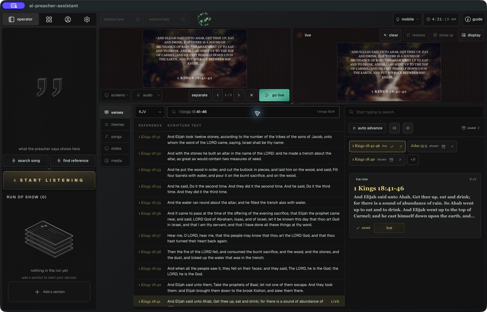

# Scripture workspace review — 2026-10-18

Reviewed the local Electron app at 1400 × 900 using the project's UI Design Checklist. This is a working-tree review, not a release or microphone-accuracy certification.

## Top 3 priorities

1. **Passage continuity — addressed.** Genesis 6:9–11 stays together. The reported 1 Kings 18:41–46 reading advances through 41–42, 43–44 and 45–46 on preview and live. Page controls sit beneath preview; Clear and Restore retain the same page. Scripture fitting preserves the complete wording.
2. **Selection and control hierarchy — addressed.** Individual reference tabs replace the History control, show the newest entries first, and expose save, dismiss and +N overflow. The catch area uses 40% of the library width, up from 30%. The selected reference uses a gold border and serif text; previous/next controls sit beside Auto advance.
3. **Search readability — addressed, compact-layout limit remains.** Shared words are highlighted, and long results begin near matching wording. The result text has an 11px minimum. With the library expanded high, the preview is physically small; lower the library for a larger view and verify projected readability in the room.

## Findings by category

- **Getting started — pass:** clear/restore labels describe the paired actions. Auto advance's tooltip explains reading completion and prayer pauses.
- **Typography — pass with a compact-layout limit:** yellow references use serif text. Passage pages preserve complete text; catch excerpts remain intentionally shortened. A small monitor preview does not establish back-row readability.
- **Layout — pass:** catches have more width; overflow references remain accessible; pagination is beside preview rather than the live image.
- **Color — pass:** selection, live state and matching words have distinct visible cues. Theme exploration leaves the live theme unchanged when scripture is sent.
- **Style — pass:** Focus and Settle are the two exposed transitions. Clear and Restore ease visibility; reduced motion is respected.
- **Imagery — implementation reviewed:** surrounding gradients use cached 16×16 image color samples and CSS motion. Preview and live use independent arrangements. Cross-origin images that cannot be sampled fall back to the blurred image. No hardware power measurement was performed.
- **Elements — pass for checked paths:** next/previous move the passage in order; outside click dismisses search without publishing a result; remembered passages rebuild their pages; failed catch sends retain the catch and show an error.

## Verification

- Desktop checks: typed Genesis and Kings ranges; page navigation; Clear/Restore; a draft sans-serif preview with a new scripture retaining the serif live theme; Focus/Settle options; matching words in a 1 Corinthians 15 result; outside dismissal.
- Automated checks cover repeated live references, Jude shorthand, numbered-book ambiguity, delayed Genesis and Kings reference fragments, repeated “verse” in ranges, full-reading completion, paused speech, page navigation, cached chapter requests, search context, highlights and scripture memory.
- TypeScript and the production bundle pass. All 558 targeted tests pass across the main run and isolated retries. A parallel run caused model-loading timeouts; five affected suites passed with one worker, and the remaining recognition suite passed in isolation (9 tests, 4.67 seconds total; its previously timed-out test completed in 1.66 seconds). The isolated command allowed a 15-second test timeout without changing repository configuration.
- Product-guide anchors pass. The overall product-map checker still reports source-snapshot drift across broader pre-existing workspace changes; the global snapshot was not rewritten.
- No live microphone-to-projector rehearsal was performed. Prayer detection depends on configured voice-command phrases, not general inference of every prayer.

## Captured workspace

