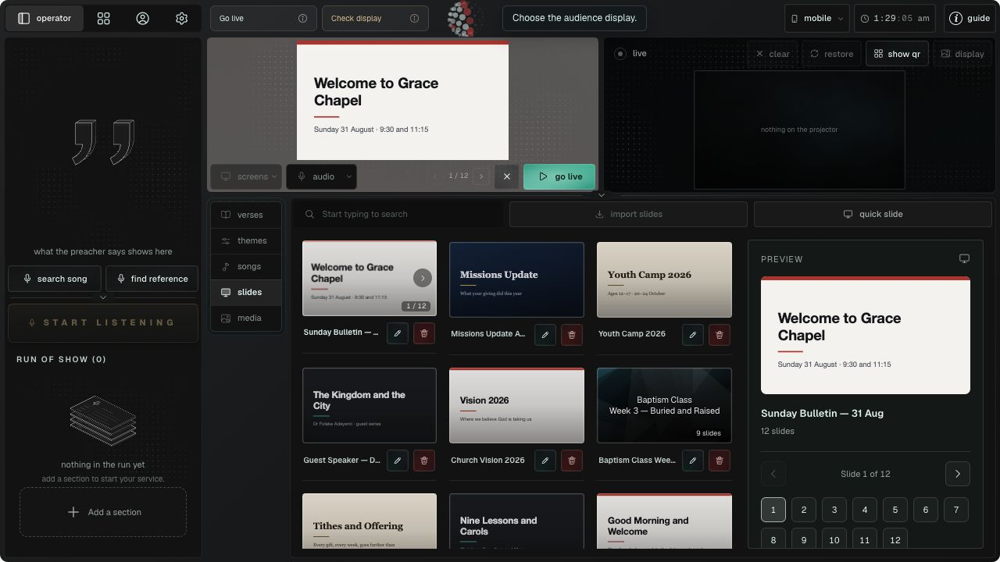
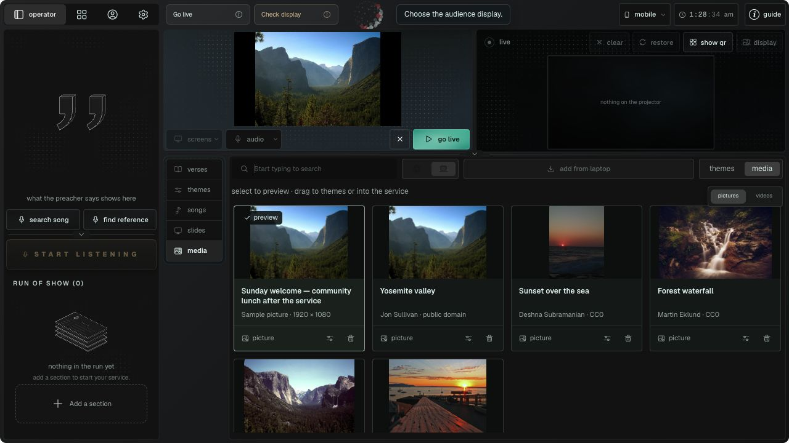
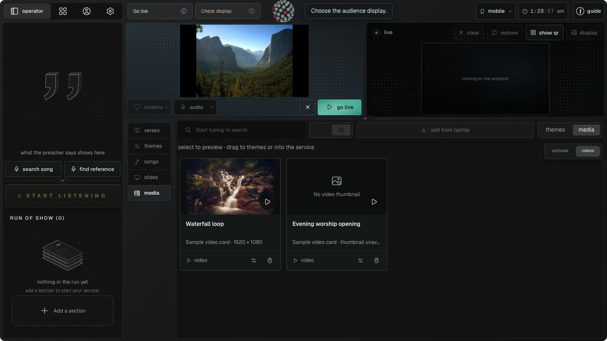

# Slides and Media UI review · October 26, 2026

This browser fixture renders the actual Live screen with sample content on a separate local origin, without the Electron bridge. It does not import into the operator's library or change projector output. The video fixtures exercise card appearance and selection, not playback; their posters are bundled sample pictures.

Run `node_modules/.bin/vite --config artifacts/slides-media-review/vite.config.mts` from the repository root, then open `http://127.0.0.1:5185/artifacts/slides-media-review/index.html`.

## UI Checklist Review

### Top 3 Priorities

1. Addressed: Slides page controls stage the chosen page without sending it live. Searching keeps the inspected deck visible.
2. Addressed: Media names, type labels and actions remain visible without hovering. Thumbnails preserve portrait and landscape proportions.
3. Addressed: New card captions and preview details have minimum text sizes so compact density does not reduce metadata to 9px.

### Findings by Category

**Getting Started — PASS**
- The side panel is limited to preview and page navigation. Existing Slides toolbar and search remain in place; Songs code was compared byte for byte with the pre-edit backup.

**Typography — PASS for changed components**
- Media titles use at least 12px and metadata at least 11px. The side preview title uses at least 13px. Two-line media names and full accessible labels handle long filenames.

**Layout — PASS at reviewed sizes**
- Reviewed at 1280×720, 1024×768 and 800×700. The library grid reduces its column count; the preview remains usable. No horizontal overflow in the Slides workspace at the default size.

**Color — PASS**
- A neutral preview badge distinguishes selection; the existing yellow color is reserved for live state. Status is also expressed in text.

**Style — PASS**
- Shared radii, icons and density tokens are used. Scoped styles leave Songs and theme cards unchanged.

**Imagery — PASS**
- Full image proportions are retained. Video cards show a play marker; a missing poster shows an explicit fallback. Real playback and native presentation conversion were not exercised in this fixture.

**Elements — 1 pre-existing finding**
- New card and preview controls have accessible labels, focus outlines and disabled boundaries. Keyboard media selection, first/last page boundaries and partially rendered decks were exercised.
- The existing deck-thumbnail pager still announces “previous verse” / “next verse.” This belongs to the shared SlideThumb pager and was outside the requested side-preview change. The new panel uses slide-specific labels.

**Tactics — PASS within scope**
- Checked search persistence, long captions, portrait photos, empty preview, video poster fallback and partially prepared presentations.

### Validation

- `npm run typecheck`: passed.
- `git diff --check`: passed.
- `node scripts/check-product-map.mjs --anchors`: passed; existing unrelated lesson coverage warnings remain.
- Focused test run: 52 passed, 2 failed. Media preview (11), presentation import (21) and product-guide (10) tests passed. Guide walkthrough tests passed 10 of 12.
- The two walkthrough failures concern existing output clear/restore instructions and the final action in other guide lessons. Their task records are identical to the pre-edit backup; this change modifies only `media.import-preview-local` and `slides.import-deck`.

### Summary

The requested side preview and local picture/video cards are implemented and browser-reviewed. Native file conversion, real video playback and release availability require their usual desktop checks. Screenshots contain sample content.

