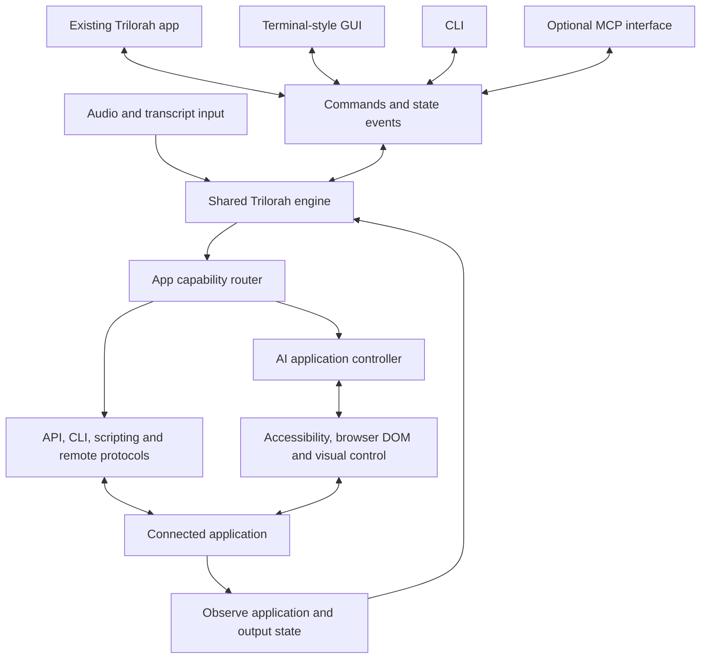

# Trilorah runtime and app control build plan

Build a persistent Trilorah engine that serves the existing app, a terminal-style GUI, and a CLI. The operator can listen, find scripture or songs, inspect the result in Trilorah, and press **Go Live** to put that exact selection into another application. An AI controller discovers and operates unfamiliar applications, then retains validated workflows so repeated actions become faster.

“Trilorah Console” is a working name for the new GUI. This is an implementation plan, not a claim of released compatibility. Checkout location: `/Users/ayotomiwa/Library/Mobile Documents/com~apple~CloudDocs/Documents/ai-preacher-assistant`. Source baseline: commit `0c7d8c3`, package version `0.4.11`, reviewed on November 9, 2026. External integrations below have documentation or source evidence; they still need tests in the actual applications.

The central decision is to give every client the same commands and state. Recognition, app control, and presentation rendering have separate responsibilities. The engine continues hearing while an app controller is working.



**Start with the engine we have.** Preserve recognition behavior while changing how it is hosted and called.

| Existing source | Reuse and required change |
| --- | --- |
| [Reference resolver](</Users/ayotomiwa/Library/Mobile Documents/com~apple~CloudDocs/Documents/ai-preacher-assistant/electron/engine/referenceResolver.ts>), [engine modules](</Users/ayotomiwa/Library/Mobile Documents/com~apple~CloudDocs/Documents/ai-preacher-assistant/electron/engine>), [LLM orchestration](</Users/ayotomiwa/Library/Mobile Documents/com~apple~CloudDocs/Documents/ai-preacher-assistant/electron/llm>) | Retain incremental reference recognition, intent, matching, context, and slower reasoning. Inject data, audio, event, and model-provider interfaces where they depend on the desktop host. |
| [Verse delivery](</Users/ayotomiwa/Library/Mobile Documents/com~apple~CloudDocs/Documents/ai-preacher-assistant/electron/engine/verseDelivery.ts>) | Preserve the distinction between preview and operator-controlled live content. Extend its protection against overtaken asynchronous actions to selections, target apps, and output revisions. |
| [Song matching](</Users/ayotomiwa/Library/Mobile Documents/com~apple~CloudDocs/Documents/ai-preacher-assistant/src/lib/songMatch.ts>) | Move the pure matching functions into the shared engine. Preserve the different thresholds for requested searches and unsolicited suggestions, scripture suppression, and stable match cards. |
| [Song store](</Users/ayotomiwa/Library/Mobile Documents/com~apple~CloudDocs/Documents/ai-preacher-assistant/electron/songs/store.ts>) | Reuse library storage through an injected data-directory interface. Add external library IDs, section mappings, source revisions, and incremental indexing. |
| [Main process](</Users/ayotomiwa/Library/Mobile Documents/com~apple~CloudDocs/Documents/ai-preacher-assistant/electron/main.ts>), [emitters](</Users/ayotomiwa/Library/Mobile Documents/com~apple~CloudDocs/Documents/ai-preacher-assistant/electron/emitters.ts>) | Extract orchestration and replace direct window broadcasts with typed engine events. Move listening and connection lifetime out of window-close handling. |
| [Remote server](</Users/ayotomiwa/Library/Mobile Documents/com~apple~CloudDocs/Documents/ai-preacher-assistant/electron/integrations/websocketServer.ts>), [Companion module](</Users/ayotomiwa/Library/Mobile Documents/com~apple~CloudDocs/Documents/ai-preacher-assistant/integrations/companion-module-trilorah/README.md>) | Preserve pairing and existing remote clients through a compatibility adapter. Its current success acknowledgment means a handler ran; add a separate operation result and observed output state. |
| [Importers](</Users/ayotomiwa/Library/Mobile Documents/com~apple~CloudDocs/Documents/ai-preacher-assistant/electron/importers>), [output modules](</Users/ayotomiwa/Library/Mobile Documents/com~apple~CloudDocs/Documents/ai-preacher-assistant/electron/output>) | Keep file import and native output as separate capabilities. An EasyWorship or ProPresenter importer does not establish control of the running application. |

The microphone path needs particular attention: `emitMicRequest` currently asks a renderer to capture microphone PCM when SoX is unavailable. A CLI-only session must have its own supported capture host. Some provider files were unavailable during inspection; hydrate and inspect them before choosing the capture implementation or estimating extraction effort.

**The operator flow stays consistent across applications.**

1. Start listening or enter a search. Transcript partials update continuously.
2. Trilorah resolves candidates using its existing engine. “Find song” searches the recent transcript against indexed lyrics, including a connected application's library when available.
3. Select a candidate. Trilorah freezes a preview selection with the reference or song section, exact text, translation, source, and revision. New speech can add candidates without moving that selection.
4. Prepare the target when its capability has been proven to leave current output unchanged. Otherwise preparation stays local until the operator acts.
5. **Go Live** captures the selection and destination, then runs the appropriate direct command or AI workflow.
6. Show the requested operation separately from the target's observed state. Next, previous, clear, blackout, and manual changes in the target app update the same control surface.

Scripture text comes from the selected Bible data. AI can identify a reference or operate an app; it does not invent the verse text. If the target resolves scripture itself, validate its translation and text against the selection. For songs, preserve the actual arrangement and section/slide mapping instead of selecting by title alone.

**The shared runtime owns state and execution.** Use framework-independent TypeScript for the core, hosted in a long-lived local process. Begin by invoking the extracted core from the existing Electron host; move it into a supervised runtime once the interfaces and behavior are stable. This lets us validate each extraction without rewriting the whole app at once.

Proposed boundaries can begin as folders within this repository:

```text
core/                 recognition, candidates, selection, live coordination
runtime/              lifecycle, providers, persistence, workers, local server
shared/control/       versioned command, event, capability and error schemas
cli/                  command parsing, output formatting, runtime client
connectors/           app-specific and native Trilorah output adapters
automation/           AI controller, app profiles, platform tool executors
src/console/          terminal-style React GUI
```

The runtime keeps audio sessions, models, indexes, and target connections warm. CLI invocations attach to it; they do not reload the engine for each command. One runtime owns writes to its library and settings. Put CPU-heavy work and desktop automation in supervised workers/helpers with bounded queues so they cannot block transcript intake or the command dispatcher. Closing an operator window does not silently stop a listening session. Explicit stop and quit actions remain available.

Choose Node as the target runtime host, subject to the capture and native-module spike. Check `better-sqlite3`, ONNX, Whisper, resource paths, and packaged binaries against the chosen Node/Electron ABI. If an Electron capture host is temporarily required, ship it as an explicit supervised helper and document that dependency. Native Trilorah projection also needs an output-window host. “CLI-only” means no operator GUI is required; GUI automation still operates within the target application's logged-in desktop session.

Use typed JSON-RPC 2.0 commands and notifications over local IPC, with a Unix socket on macOS and a named pipe on Windows, restricted to the current user. Specify framing, message limits, protocol negotiation, cancellation, and reconnect snapshots. Preserve the existing paired WebSocket remote interface as an adapter rather than changing its contract underneath existing clients. A later MCP server wraps these same commands; it does not own recognition or introduce a second execution path. [JSON-RPC specification](https://www.jsonrpc.org/specification), [Claude Academy on defining MCP tools](https://academy.claude.com/courses/introduction-to-model-context-protocol/defining-tools-with-mcp).

Core commands cover listening, scripture/song search, candidate selection, app discovery/connection, take, navigation, clear/blackout, cancellation, state, and event subscription. Events carry a runtime epoch and ordered sequence so clients can detect gaps and request a fresh snapshot. Keep transcript events bounded and coalesce superseded partials; preserve final transcript lines and operation results.

Every live operation carries an operation ID, immutable selection ID/revision, target ID, connection generation, deadline, and expected live revision. Deduplicate repeated submissions. Recheck these values immediately before any action that can change output. Cancel work overtaken by a newer operator action or target-side manual change. A timeout after sending means the outcome may be unknown: observe the app before retrying. Do not replay an old Go Live command after reconnecting.

Track four distinct facts: what was selected, what was requested, what the app reports, and what output was actually observed. A connector may report an active slide without proving the projector is showing it. The GUI and CLI must expose that distinction. Where output evidence is unavailable, show an unverified state with its last observation time.

**The CLI is a complete client of that runtime.** Proposed syntax:

```sh
trilorah listen start
trilorah apps discover
trilorah apps connect --app propresenter
trilorah search scripture "John 3:16" --translation WEB --json
trilorah search song --from-transcript --json
trilorah preview select cue_42
trilorah live take --selection sel_17 --target sanctuary --wait observed
trilorah live next --target sanctuary
trilorah live clear --target sanctuary --layer text
trilorah events --follow --json
trilorah status --json
```

IDs above are examples. Add discoverable help, shell completion, structured errors, stable exit codes, and dry-run operation plans. Single results use JSON; event streams use newline-delimited JSON. Keep diagnostics on stderr. Ctrl-C ends a CLI watch or cancels its current operation without implicitly stopping the shared listening session. `--wait observed` succeeds only when the requested observation level is met.

**The GUI uses terminal structure with Trilorah's identity.** Build it in the existing Electron/React stack as a selectable console workspace. Use real controls and structured state, with a command prompt that calls the same commands as the CLI.

Apply the documented [Trilorah brand palette](</Users/ayotomiwa/Library/Mobile Documents/com~apple~CloudDocs/Documents/ai-preacher-assistant/src/brand-system/README.md>) to this new console: green black `#010806` for the canvas, deep green `#07271C` for panels, pale mint `#E5F3F2` for primary text, and yellow `#E4D87A` for focus and the primary action. This extends the confirmed site palette into the console. Reuse the existing Trilorah mark. Use the current [Geist and Geist Mono font definitions](</Users/ayotomiwa/Library/Mobile Documents/com~apple~CloudDocs/Documents/ai-preacher-assistant/src/index.css>): mono for the prompt, transcript, timestamps, and status; readable larger type for the selected scripture or lyrics.

Conceptual layout with sample state:

```text
TRILORAH                                    Listening   ProPresenter connected
─────────────────────────────────────────────────────────────────────────────
HEARD                                PREVIEW
08:42:11  Turn with me to John...     John 3:16 · WEB
08:42:12  chapter three, sixteen.     For God so loved the world...
                                     Selected · ready
CANDIDATES                           [ Go Live ]
> John 3:16 · explicit reference      ────────────────────────────────────────
  John 3:16–18                       LIVE IN PROPRESENTER
                                     Psalm 23:1 · app reports active
                                     [ Previous ] [ Next ] [ Clear ]
─────────────────────────────────────────────────────────────────────────────
trilorah > search song from transcript
```

The preview holds its position while candidates and transcript continue updating. The live pane remains visible when search, app connection, or AI progress is open. Display a target preview image only when it comes from that target; otherwise label the local preview as content, without implying identical target formatting.

The prompt accepts direct references, song searches, explicit commands, and natural-language app tasks. Resolve each request into the shared typed command surface; show ambiguous selections for the operator to choose. New content still reaches the preview before Go Live.

Use visible buttons alongside keyboard commands. Enter submits a search or selects a result; an explicit Go Live control or dedicated shortcut commits it. Scope shortcuts so typing cannot accidentally send content live. Keep command history separate from the transcript. Provide transcript follow/pause, readable scaling, clear focus, keyboard navigation, and screen-reader semantics. Avoid decorative typing effects and animation on repeated keyboard actions. AI progress should explain the current task, such as “Finding the song in this app,” with cancel/take-over controls.

**App support is described by capabilities.** A connector declares what it can discover, search, index, prepare, take, navigate, clear, and observe. Each capability identifies its route, constraints, verification method, and tested app versions. Routes may be mixed within one application: API for navigation, UI automation for Bible search, and a message/text input for spontaneous scripture. Preserve action scope: an app's “clear everything” operation cannot silently satisfy a request to clear only text.

| First application experiments | What to prove |
| --- | --- |
| ProPresenter | Its published API exposes presentation/slide control and Messages with text tokens. Test existing-song indexing plus a dedicated themed Message for spontaneous scripture. Establish that inactive preparation leaves output unchanged, then test triggering, wrapping, clearing, and manual overrides. Native Bible lookup is not exposed in the reviewed specification; investigate a separate UI workflow when that behavior is needed. [Published API](https://openapi.propresenter.com/swagger.json). |
| FreeShow | Use its documented scripture, show creation/text, slide control, and output-reading actions as a second rich integration. Validate translation selection and the actual preview-to-live boundary. This is a useful portability check against assumptions inherited from ProPresenter. [API documentation](https://freeshow.app/api). |
| EasyWorship | The Companion module demonstrates remote navigation and display controls. Inspect the official remote's library/schedule behavior on a controlled installation, then map additional requests where present. Test UI Automation for capabilities the remote path does not expose. Existing module coverage is evidence of a starting point, not a ceiling on what we can build. [Companion source](https://github.com/bitfocus/companion-module-softouch-easyworship/blob/main/src/actions.js), [official remote setup](https://support.easyworship.com/support/solutions/articles/24000039297-remote-app-and-android-phone-setup). |
| An unfamiliar application | Select an app after the generic controller is built, with no app-specific profile supplied. Demonstrate discovery, content selection/preparation, taking live, observation, and navigation through the generic tools. Record where a capability needs another route or remains unverified. |

An application without a native song or Bible library can still receive Trilorah-resolved content through an editable text field, generated/imported slides, or a supported content source. A content-source route is a distinct capability from controlling that app's own library and presentation state. Select the route that preserves the intended workflow and verify it in that app.

Index connected libraries locally when the app can provide content. Retain external IDs, arrangement/section mappings, and change markers. Avoid opening and searching the target UI for every transcript partial. If indexing is unavailable, the explicit search request can use an AI-driven app search while recognition continues.

**AI handles unfamiliar and changed apps during operation.** Implement a separate controller with a bounded observe → plan → act → verify loop. It receives a structured task from the runtime, the selected content, the target scope, and the current operation deadline. The model uses a common tool interface; provider choice can be benchmarked without changing the engine contract.

1. Inspect the selected app's identity, version, available API/CLI/scripting interfaces, accessibility tree or browser DOM, and visible state.
2. Map the requested Trilorah capability to a concrete sequence. Prefer stable semantic controls and direct interfaces when they exist; use visual grounding for custom or inaccessible controls.
3. Execute through platform tools and check postconditions. Before each output-changing step, revalidate the live operation and current target state.
4. Save a successful workflow as a versioned declarative profile containing app identity, selectors or endpoints, parameters, preconditions, verification, and cancellation behavior. Retain evidence of what was tested.
5. Reuse the profile on subsequent operations. Reinspect and repair it when versions, language, layout, or observed controls change. A demonstration from the operator can supply a missing workflow.

macOS Accessibility and Windows UI Automation expose semantic elements and actions when applications provide them; browser apps can expose DOM controls. Visual control covers additional surfaces. These are complementary routes, with app-specific exposure limits. [Apple accessibility model](https://developer.apple.com/library/archive/documentation/Accessibility/Conceptual/AccessibilityMacOSX/OSXAXmodel.html), [Windows UI Automation](https://learn.microsoft.com/en-us/windows/win32/winauto/uiauto-uiautomationoverview).

A generated profile uses validated tool calls rather than arbitrary executable code. Transcript text and app content remain task data; they cannot expand the controller's authority. Scope capture and input to the connected app, and make required platform permissions part of connection setup. Human input or target-side manual changes interrupt conflicting automation. A desktop input lease prevents two workflows from typing into different windows at the same time. API operations can remain independent of that lease.

Unknown workflows can require several observations and model calls. Measure that separately from engine recognition and saved-workflow execution. Warm profiles, prepared content, and direct calls preserve speed where possible; a first encounter with an unfamiliar UI has a different latency profile. If an operation cannot finish or verify within its budget, retain the selection and expose its actual state so the operator can continue deliberately.

**Build in these reviewable steps.** The first step tests both direct integration and unfamiliar-app control; neither is deferred until after a major refactor.

| Step | Deliverable | Completion evidence |
| --- | --- | --- |
| 0. Prove the difficult boundaries | Record the recognition baseline; inspect remaining capture dependencies; prototype spontaneous scripture and an existing song in ProPresenter or FreeShow; attempt the same workflow in an unfamiliar app using generic tools. Test the proposed runtime host's audio/native-module packaging. | Actual output recordings and operation traces, latency breakdowns, a capability matrix, and specific unresolved gaps. Produce an effort estimate after this evidence. |
| 1. Establish the command and state contract | Add typed schemas, operation IDs, selection/live revisions, cancellation, event snapshots, and a fake connector. Route existing operator and remote actions through this dispatcher while retaining current UI behavior. | Race and failure tests show that new speech, double presses, disconnects, and manual target changes cannot commit an unintended selection. |
| 2. Extract the shared engine | Move recognition orchestration and song matching behind injected provider/event/storage interfaces. Keep the existing Electron entry point as a client/host during migration. | Existing recognition and song behavior passes the current test/evaluation baseline; fixed transcript inputs produce equivalent results. |
| 3. Host the persistent runtime | Add process supervision, local IPC, capture/output helpers where needed, single-instance ownership, warm resources, and restart/reconnect behavior. | Listening continues with the operator GUI closed; reopening or attaching the CLI recovers current state; restart does not replay a take. Test packaged builds on both intended platforms. |
| 4. Ship the CLI client | Implement the command surface, JSON/event output, help, completion, cancellation, and diagnostics. | A scripted rehearsal can listen, search, select, take, navigate, clear, and inspect failures through the same runtime used by the app. |
| 5. Build the branded console | Implement transcript, candidates, fixed preview, observed live pane, target connection, prompt, and keyboard controls using the same client contract. | Run a complete rehearsal from the console; check focus, long verses, transcript corrections, disconnected targets, and AI cancellation without losing the selected content. |
| 6. Harden the first connectors | Turn the early direct-integration experiments into adapters with indexing, state feedback, exact target IDs, safe preparation, and tested clear/navigation semantics. Keep native Trilorah output behind the same capability contract. | Target-side manual changes reconcile correctly. External app failure does not stop recognition. Published support is limited to the capabilities and versions actually tested. |
| 7. Productize unfamiliar-app control | Add platform executors, discovery, profile creation/repair, demonstration support, scoped execution, and observed results to the earlier AI prototype. | A held-out app works without a supplied app-specific adapter; a changed layout exercises recovery; cancellation and human takeover prevent stale work from going live. |
| 8. Package and rehearse the complete system | Bundle runtime/helpers/CLI, permission setup, migration and recovery, diagnostic export, and relevant help. Add the optional MCP wrapper once the command contract is stable. | Complete a sustained service rehearsal, verify installation and recovery on target machines, and pass the project's UI review before a release push. |

Steps 4 and 5 share the client contract. Connector and automation work can advance alongside them once Steps 0–3 establish the boundaries. Each implementation change should leave the current app usable. Do not make a repository-wide package migration a prerequisite for the first working external-output slice.

**Measure the whole path.** Record time from final identifying audio to usable transcript, transcript to candidate, selection to prepared content, Go Live to dispatch, and dispatch to app/output observation. Separate cold startup, warm direct calls, saved UI workflows, and first-time AI discovery. Report p50/p95 and success/verification rates against named hardware, app versions, and fixture libraries. Set numeric release budgets from Step 0 rather than promising unmeasured response times. The extraction gate should compare recognition behavior and latency against the same pre-change fixtures and hardware.

Use the existing unit tests and recognition evaluations for the engine, contract tests with a controllable fake app for event races and ambiguous outcomes, and actual application rehearsals for rendering and automation. Specifically exercise partial/final transcript duplication, a changing preview during Go Live, duplicate requests, missing acknowledgments, manual target navigation, app restarts, changed UI layouts, incorrect translations, and long scripture/song sections. A successful API response alone cannot pass an output test.

Before implementation is considered ready to release, update the affected help, writing brief, and [product-map lessons](</Users/ayotomiwa/Library/Mobile Documents/com~apple~CloudDocs/Documents/ai-preacher-assistant/docs/product-guide/product-map.json>) to match verified behavior. Apply the project's [UI Design Checklist](</Users/ayotomiwa/Library/Mobile Documents/com~apple~CloudDocs/Documents/ai-preacher-assistant/.agents/skills/sn-ui-checklist/SKILL.md>) before the final push and report the highest-priority findings. Record unresolved platform/provider and app-version choices in this internal plan until the experiments settle them.

**First working demonstration:** with the console and CLI attached to one warm engine, speak a reference, see it in Trilorah's preview, press Go Live, and observe it in an external app. Then find a song from recent speech and take its selected section live. Repeat the workflow in an unfamiliar app through AI control, keep listening throughout, and confirm that a manual change in the target is reflected back in Trilorah.

**Claude review request.** The current app-terminal connector can read the user's Claude Code session but cannot send input. Computer control of this host app is also blocked, so the request below has not been sent. Paste this into the open Claude Code session:

> Read `docs/engineering/TRILORAH-APP-CONTROL-PLAN.md` in this repository and critique the architecture against the existing code. This is a planning review only: do not edit files, install anything, change settings, or run app/output automation. Focus on hidden Electron/renderer dependencies, headless audio and native-module packaging, selection/live-state races, connector verification, and whether the unfamiliar-app AI test proves genuine portability. Preserve the goal of one Trilorah engine serving the existing app, terminal-style branded GUI, CLI, and AI-controlled external apps. Return the five most consequential corrections with file evidence and a recommended first implementation slice. Distinguish inspected facts from assumptions, and identify any unavailable source files rather than guessing.
