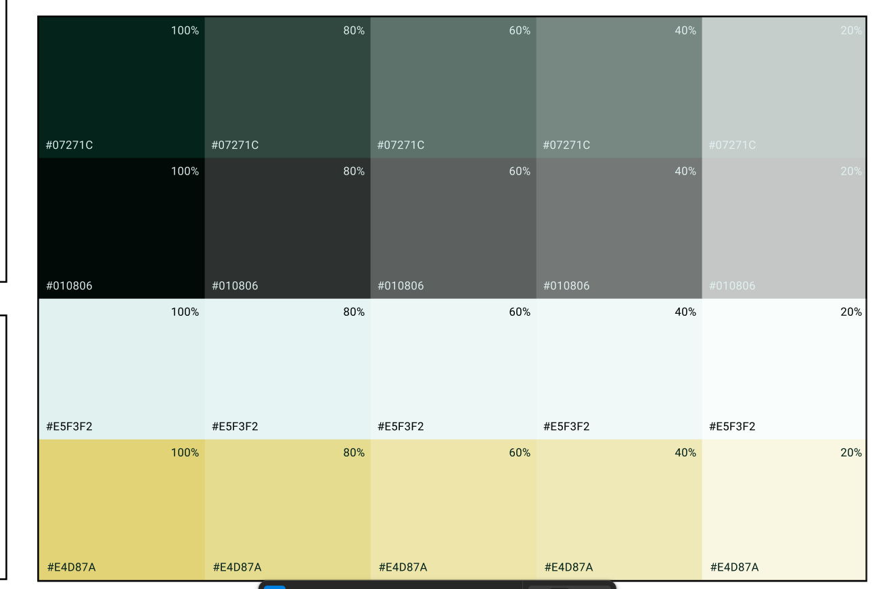

# Brand component workspace

Open `/brand?section=components` on the web dev server. The original identity boards and `/brand-directions` are preserved.

## Site accent palette

Confirmed by the user on October 15, 2026. Use these exact base colors for future site accent work.

| Color | Hex |
| --- | --- |
| Deep green | `#07271C` |
| Green black | `#010806` |
| Pale mint | `#E5F3F2` |
| Yellow | `#E4D87A` |

The supplied reference shows each color at 100%, 80%, 60%, 40%, and 20% opacity. These are opacity variants of the same base colors, not separate hex values.

## Rebuild after app changes

Run `npm run brand:components` from the repository root, then run `npm run dev` in `web`.

The build regenerates the searchable source catalogue, source excerpts, bundled font assets, and the desktop specimen bundle. The generated files are served locally from `web/public/brand`; no second preview server is required. Rebuild this bundle before reviewing a desktop code change—Next hot reload only covers the host and companion previews.

## What is represented

- **Previews:** existing desktop component sheets, additional interactive fixtures, complete screen studies, and actual companion components with sample data.
- **All components:** named JSX-producing functions, function-valued variables, and classes in desktop UI/screens and the companion/account web UI. Internal components are included. Individual icon wrappers are grouped in the icon study. Hooks, server routes, tests, and marketing pages are outside this component index.
- **Design checklist:** the original `design/UI-INVENTORY.md`, retained as review prompts. It includes planned ideas and is not a list of implemented components. Its old IDs are not used to infer matches with current source.

Items without a standalone fixture say **Source indexed**. Existing dashboard and popup wireframes are explicitly labelled. These states must not be relabelled as complete interactive previews without providing an actual fixture.

## Isolation

The desktop app uses React 19 and Tailwind 4; the website uses React 18 and Tailwind 3. `vite.brand.config.ts` builds the desktop previews separately, using the original components and styles, and the website embeds the result. No Electron preload or backend bridge is installed. A preview CSP disallows network connections. Device/cloud features need the real app.

Density and control-radius messages are validated by origin and source and only alter the preview document. Companion fixtures use their own current styles and a distinct reading-preferences key. Design notes are stored in this browser per catalogue entry; exported JSON is a proposal, not an automatic app migration.

## Adding a fixture

Use the real component with local callbacks and explicit sample data in `specimens.tsx`, then register its metadata/mapping in `scripts/build-brand-system.mjs`. For React 18 companion components, use `web/src/app/brand/companion-preview/page.tsx`. Keep service writes, authentication, live devices, and real church data out of fixtures.

Old desktop gallery prose includes superseded font/icon specifications. The brand runtime hides those archival note/spec blocks while retaining the actual specimens. Current font documentation lives in the Typography entry and is based on `src/ui/fonts.css`, `src/index.css`, and `src/ui/tokens.css`.
